# Frame Launcher

A remote-first Tizen launcher for Samsung The Frame with weather-reactive
Woodland scenery, live TV previews, and a private Robinhood dashboard.

Home brings together a market watchlist, live movie and TV listings, installed
apps, and up to eight editable favorites. Woodland follows local daylight and
weather. The interface and artwork ship with the launcher. Market data, weather,
and live previews use internet services.

## Compatibility

Frame has been installed and launched on a 2022 Samsung The Frame from the
LS03B series. The TV also reopened Frame after leaving Art Mode on firmware
`T-PTMAKUC-REL-202602250225`. Samsung lists Tizen 6.5 and Chromium 85 for its
2022 TV Web engine.
[Samsung TV Web engine specifications](https://developer.samsung.com/smarttv/develop/specifications/web-engine-specifications.html)

The app manifest sets Tizen 6.0 as the minimum. A Samsung firmware update can
affect installation, launch, live playback, or startup even when the TV's
Tizen version stays the same. Recheck those features on a different firmware
build or TV model.

When reporting a problem, include the TV model series and year, the Frame
launcher version, and the TV's software version from **Settings → Support →
About This TV**. If the problem started after a TV update, include the previous
software version if you have it.
[Samsung guide to finding the TV software version](https://www.samsung.com/us/support/answer/ANS10005222/)

## Screenshots

These screenshots show the browser preview with sample weather, listings,
market charts, and portfolio history. The portfolio trendline is visible with
all numeric portfolio information masked.

### Woodland On Home

| Clear Day | Clear Night |
| --- | --- |
| 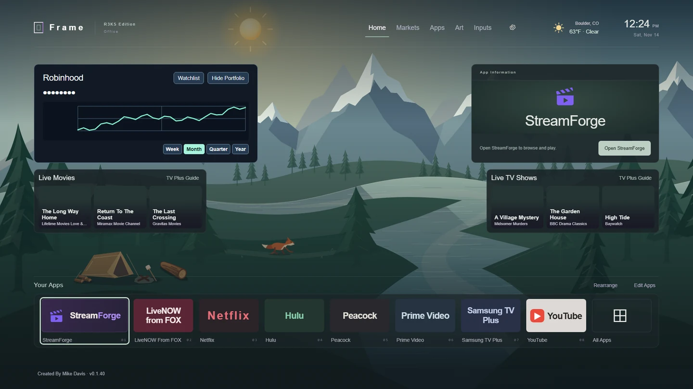 | 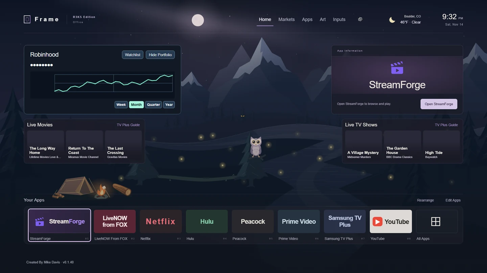 |

| Partly Cloudy | Overcast |
| --- | --- |
| 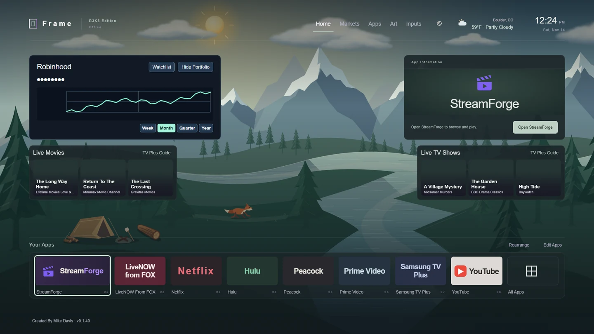 | 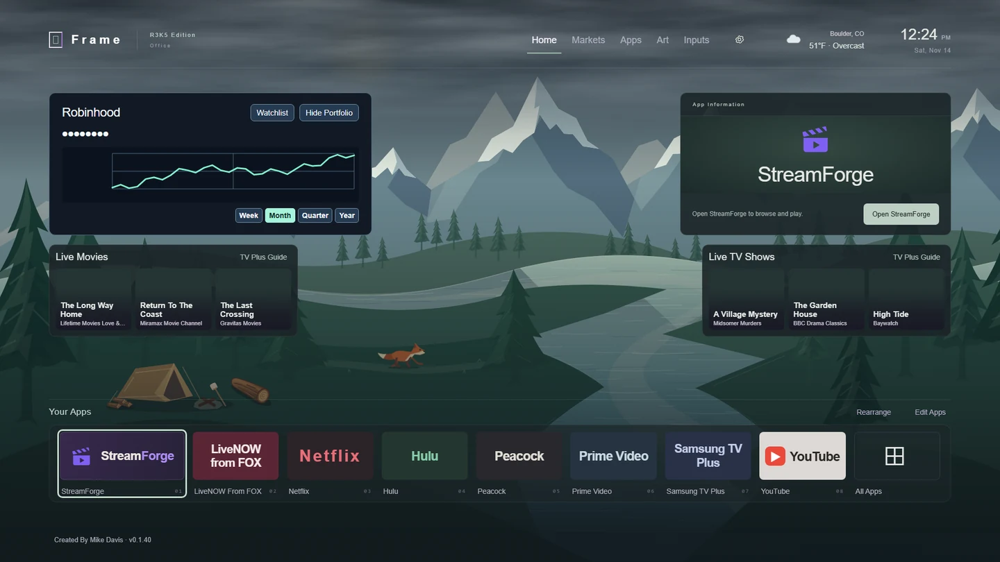 |

| Rain | Thunderstorm |
| --- | --- |
| 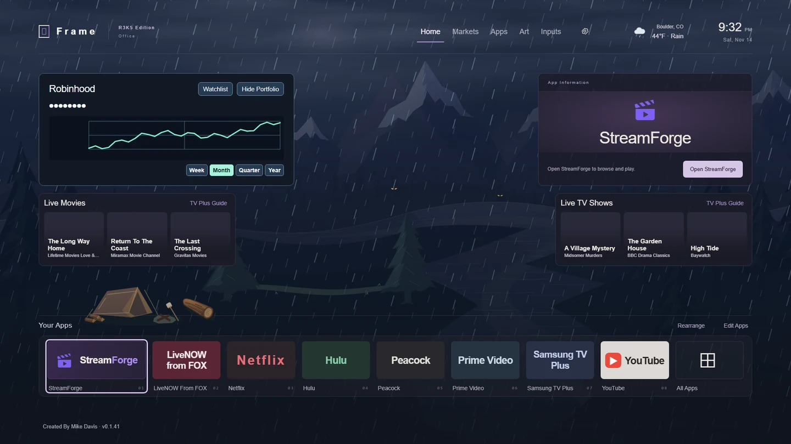 | 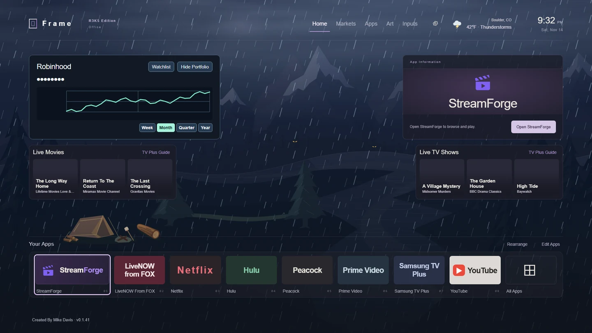 |

| Snow | Full-Screen Woodland |
| --- | --- |
| 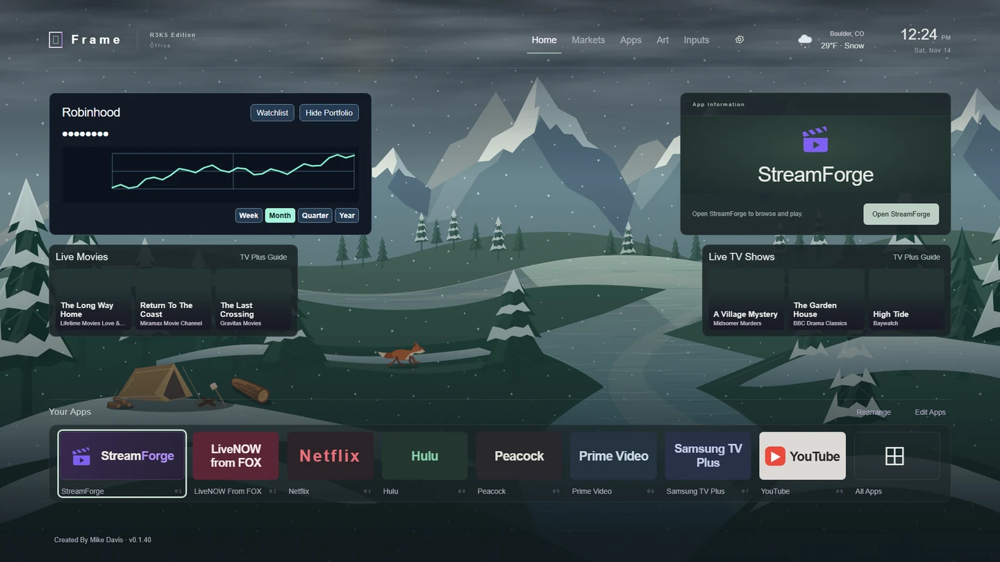 |  |

### Launcher Screens

| Markets | Apps |
| --- | --- |
| 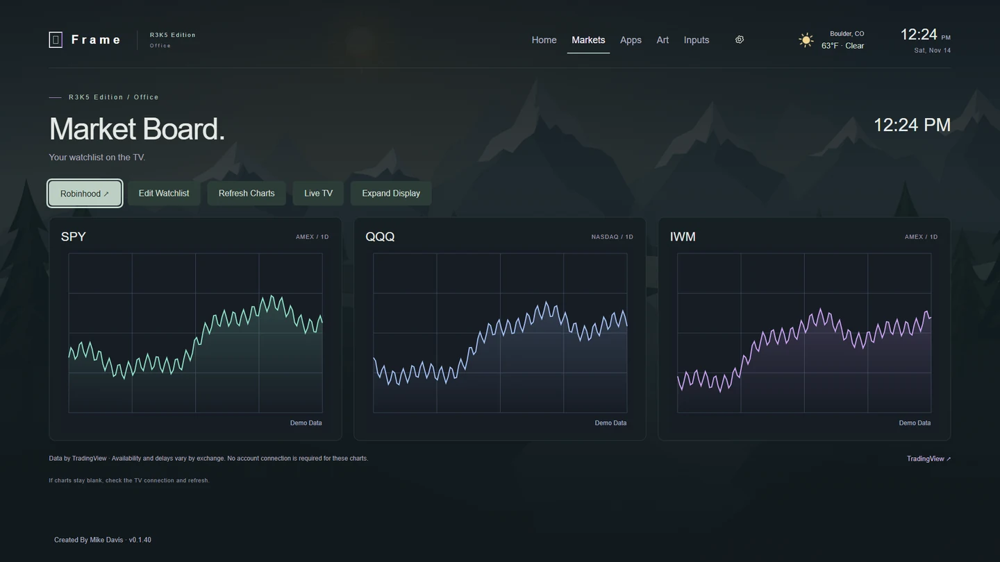 | 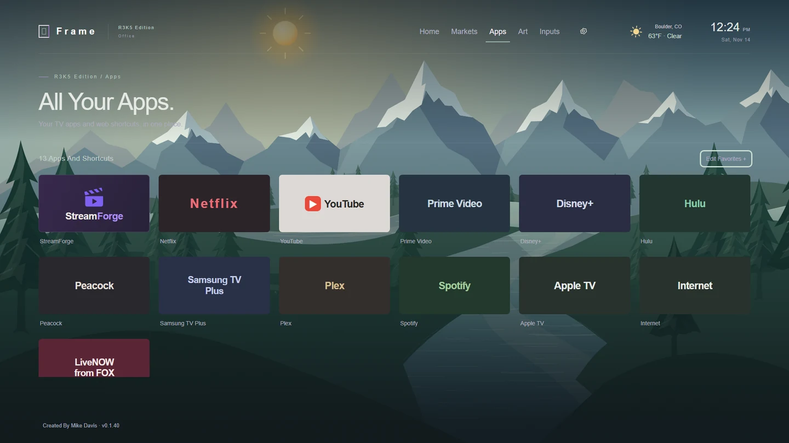 |

| Art | Inputs |
| --- | --- |
| 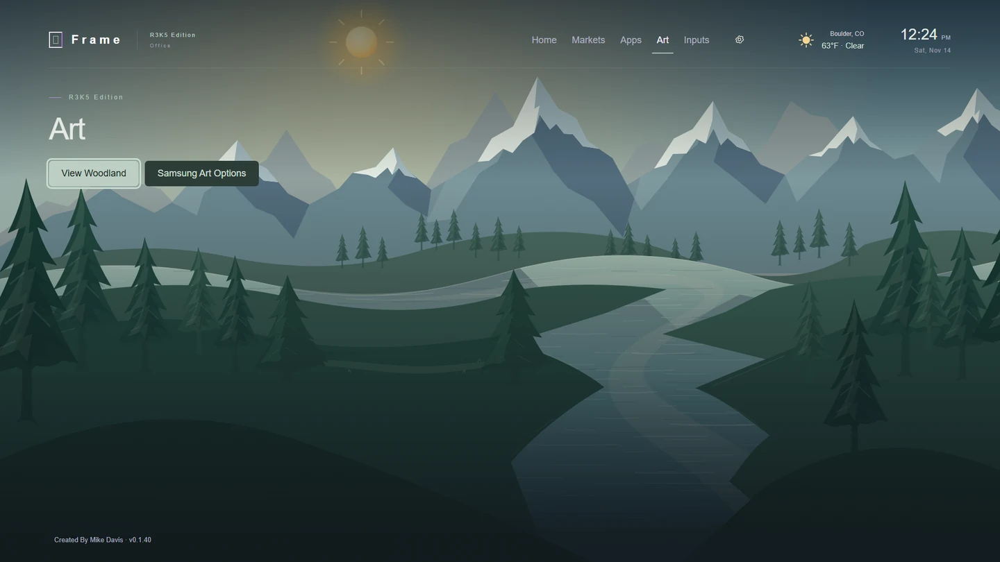 | 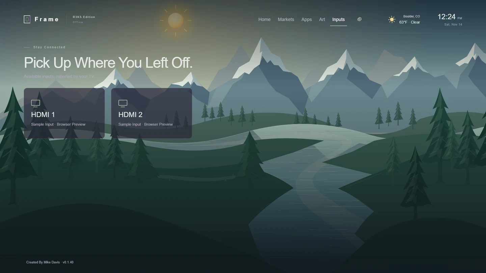 |

| Display Settings | Local Weather |
| --- | --- |
| 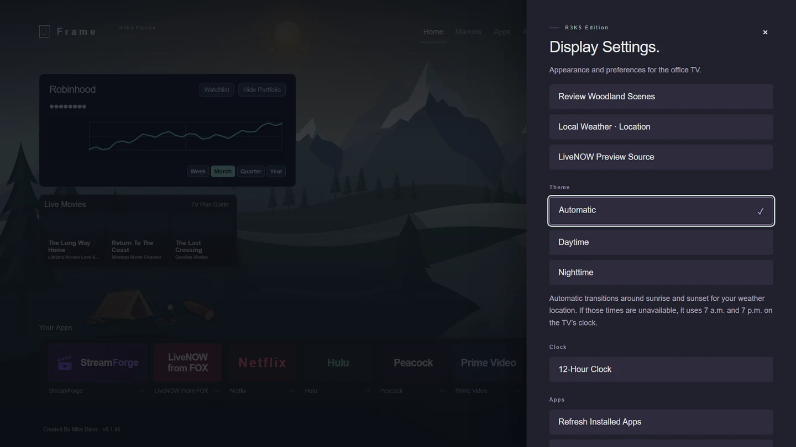 | 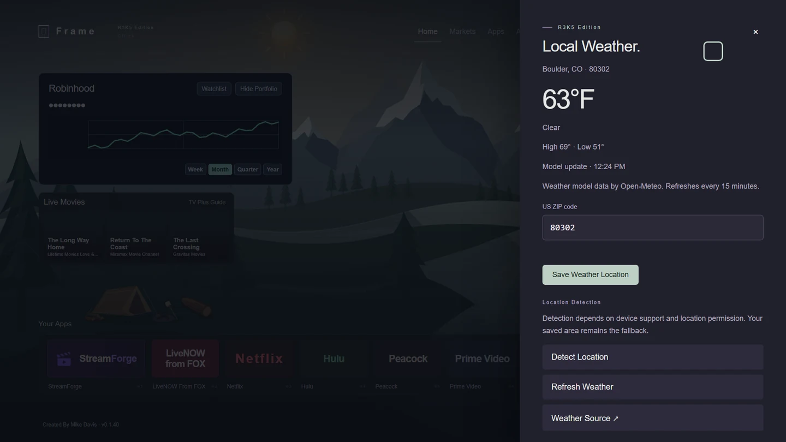 |

## Develop Locally

Install Node.js 22 or newer, npm, and Python 3. Run these commands from this
repository:

```powershell
npm ci
npm exec -- playwright install chromium
npm start
```

Open the preview at `http://127.0.0.1:4173`. Run `npm test` for the browser and
mocked Tizen tests and `npm run package` to create an unsigned WGT in `dist/`.
The package version comes from `config.xml`.

`js/app.js` coordinates navigation, dialogs, and the native app lifecycle.
`js/startup.js` tracks Home readiness and dismisses the splash. `js/weather.js`
fetches weather and saves the selected location. `js/woodland-display.js` applies
the clock and weather to the scene. `js/home-market.js` renders the watchlist and
portfolio. Shared DOM controls live in `js/ui.js`. Tizen APIs stay in
`js/platform.js`. The launcher loads these scripts directly from the WGT for
compatibility with the TV's browser.

Keep signing certificates, private WGTs, workstation logs, local preview captures,
and portfolio pairing data out of Git. The committed portfolio configuration
is an empty stub. Private builds receive a display token at packaging time.

The home screen shows a TradingView quote ticker and saved watchlist shortcuts
beside the highlighted app’s preview. Quotes may be delayed. Choose a symbol
to open its chart in Markets, or Open Markets for all
saved charts. Use Display Settings to choose a theme or follow the automatic
schedule.

Choose Rearrange beside Your apps to change the dock order. With the remote,
press OK to pick up a tile, Left/Right to move it, and OK to place it. Choose
Done or press Return to finish. A mouse can drag tiles while Rearrange is active.
Changes save immediately and survive relaunch. Edit apps adds/removes favorites.
Neither picking up nor moving an app launches it.

The remote follows the position of controls on screen. Each arrow prefers an
aligned control and can reach staggered controls in the same direction.
The focus outline slides between controls and honors the device's reduced-motion
setting. The owl on the center pine blinks about every 13 seconds.
At the right edge of the watchlist controls, Right enters the app preview.
From the preview’s leftmost control, Left returns to the watchlist.

The R3K5 edition uses a dark interface and a numbered app dock with a dedicated
StreamForge tile. Woodland is the launcher background in both themes,
with a lake, distant mountains, and pines. At night it adds the moon, stars,
fireflies, and an owl on a pine branch. Firefly animation respects
reduced-motion preferences.

## Office display

Automatic uses the TV’s clock to choose day or night. On Woodland Home, the
ten-minute fades end at 7 a.m. and 7 p.m. The sun and moon trade places behind
the same mountain at the midpoint. The campsite's fire, owl, and distant blinking
eyes can appear when the nighttime fade finishes. Rain, thunderstorms, and
strong wind keep the campfire unlit. On clear and partly cloudy nights,
brighter fireflies drift and pulse near the water. Both interfaces and their market
charts stay dark. The daytime fox
crosses the bank, disappears behind a pine, and returns with a fish. The owl
blinks in the moonlit woodland. The lower app dock and compact live shelves
leave room to see the artwork in both themes.

On Home, the woodland follows current local conditions. Clear skies show the
sun or moon, while unsettled weather adds drifting clouds, rain, lightning, or
snow. Snowfall adds snow to the ground and trees. The TV uses bundled landscape
images and CSS layers for the animation. Reduced motion keeps the conditions
visible as a static scene. With the preview server running, regenerate the TV
landscape images from the SVG with `node tools/capture-woodland.cjs`.
Frame checks the display theme every ten seconds while active and immediately
on return to the foreground. Display Settings offers Automatic, Daytime, and
Nighttime. Manual choices persist.

Default favorites include StreamForge, LiveNOW from FOX, Netflix, Hulu,
Peacock, Prime Video, Samsung TV Plus, and YouTube. Existing docks
get YouTube once when the app is found and a slot is available. On TV, only
discovered installed services are pinned, alongside the StreamForge web shortcut.
The Live TV button opens Samsung TV Plus. On this Frame, Tizen marks the TV Plus
entry point hidden, so the launcher also checks for that specific installed app.

Live movies and Live TV shows display up to three currently scheduled programs
from selected U.S. TV Plus channels. Listings refresh every 15 minutes from
Matt Huisman's Samsung TV Plus XMLTV feed, and end times use the TV's clock.
Select a program for details, including the channel, then open Samsung TV Plus
to watch. The panels display a guide shortcut when listings are unavailable.
Home fills both program rows with up to three channels that have preview feeds.
Highlight a movie or show to play its muted preview directly from the internet.
When focus is outside the live cards, Home previews LiveNOW from FOX if it is
pinned, or an available live card. The TV plays one preview at a time through
the bundled HLS player.
Other cards show still artwork. A stalled or unavailable feed returns to its
artwork. Previews pause in dialogs and when leaving Home, and respect reduced
motion. The development PC and FFmpeg preview service are unnecessary for playback.

On Tizen, Frame responds to a Home launch operation by showing the Home screen.
To reach Samsung's menus, select **Open Samsung Smart Hub** in Display Settings.

Markets opens a three-chart watchlist with SPY, QQQ, and IWM as initial display
symbols. Edit watchlist accepts up to three exchange:ticker symbols and saves
them locally. TradingView charts run in separate frames and keep the provider's
branding and attribution. Data availability and delays depend on the provider
and exchange. **Refresh Charts** reloads the frames, and **Expand Display**
hides the app header. Press Return to exit the expanded view.

On a paired TV, the Home panel starts in Robinhood with total account value,
the latest sync time, and an estimated history chart. Select **Watchlist** to
show the watchlist and **Robinhood** to switch back. The launcher remembers the
selected view. Select **Hide portfolio** to keep the public market ticker on
Home and hide the Robinhood shortcut. This setting survives restarts. Select
**Show portfolio** to reveal it again. Home starts with StreamForge focused
when it is in Your Apps.

## Weather and app previews

Weather uses a saved location or an example location on a fresh install.
Open-Meteo supplies temperature, conditions, and daily highs and lows in
Fahrenheit. The header animates the icon for the reported conditions and uses
a moon for clear skies at night. The app refreshes at launch, on resume, and
every 15 minutes while visible. Failed requests retry after a minute. The header
shows loading or unavailable until a current reading arrives and Woodland can
apply its weather effects. Frame saves your location for future requests. Select
the weather summary to change the ZIP, inspect the model timestamp, or refresh.
Frame uses Zippopotam.us to look up the ZIP and saves the location on the TV.

Enter a ZIP in **Local Weather**, or choose **Detect Location** on a device that
supports it. The detection button requests device geolocation and may ask for
permission. Frame makes no IP-based location lookup.

The home preview follows focused or hovered app tiles. Highlighting never opens
an app. App information is shown for services without a configured preview;
standard Tizen APIs do not provide a general screen-preview feed from another
running app. An explicit Open control launches the selected app.

LiveNOW from FOX is an additional default tile. Its main action always opens
the official `https://www.livenowfox.com/live` watch page, unless a visible native
LiveNOW app is discovered. The official site lists the channel on Samsung TV
Plus channel 1116, but this implementation does not claim to tune that channel
directly. It does not embed the main FOX page, whose response denies framing.

Choose Play preview to load the muted YouTube embed. Its initial source was verified from
the official LiveNOW channel on 2026-11-04. The channel-wide embed returned
unavailable in testing; a specific event ID worked. Event IDs can rotate, so
Settings → LiveNOW preview source accepts a new YouTube video URL. This is not
automatic event discovery. An API-backed resolver or an approved stable feed
would be needed for that. Embedding, autoplay, and playback remain subject to
provider and TV-browser support; the watch-page shortcut remains independent.
Frame stops the video when you change selection, leave Home, background the app,
or open Woodland full-screen.

## Preview

Run `npm start`, then open http://127.0.0.1:4173. Node 22 or newer is recommended.
Arrow keys navigate, Enter selects, and Escape or Backspace goes back.
Tab also works. On a TV the Samsung remote's directional pad, OK, and Return
perform the same actions. Return on the home screen opens an exit dialog.

StreamForge is a default Home favorite. Set `FRAME_STREAMFORGE_URL` to your
HTTPS site when packaging a build with the web shortcut. The shortcut uses
Tizen's `view` application control to open the TV browser. If a visible
installed app is named StreamForge (or StreamForge TV),
the launcher uses that app's discovered ID. Existing docks receive StreamForge
at the front once. When the dock is full, the displaced app remains under
**All Apps**. Frame remembers removals made through **Edit Apps**.

The other browser apps and inputs are samples. Preview cannot open those TV
apps or switch inputs. On Tizen, the launcher discovers apps using `getAppsInfo` and connected
sources using `systeminfo.getPropertyValue('VIDEOSOURCE')`. It never substitutes
sample data when a TV API fails. Home favorites follow the saved dock order.

**View Woodland** opens the current theme’s Woodland backdrop full-screen.
The **Art** menu also links to **Samsung Art Options**, which covers the TV’s
native Art Mode, personal-image imports through SmartThings or USB, and Art
Store membership. The Samsung artwork guide opens in the browser.

## Verification

```powershell
npm ci
npx playwright install chromium
npm test
npm run package
```

The browser tests cover remote navigation, preference persistence, dialog focus,
favorite limits, reset, storage failure, real app IDs, native API errors, input
switching, exit behavior, automatic theme boundaries, manual overrides, live TV,
Robinhood handoff, watchlist editing, weather success/failure and ZIP persistence,
location capability handling, preview selection, video cleanup, and preview source
validation, remote and mouse app rearranging, saved order, home watchlist tabs,
footer removal, and the Art navigation. The suite mocks Tizen APIs and relevant
chart and weather requests. Use the TV checks below to verify the signed package
on the target model.

`npm run package` creates `dist/Frame-<version>-unsigned.wgt`. Sign this archive
before installing it. It includes only the
manifest, HTML, CSS, JavaScript, and local artwork/icon assets.

## Install on The Frame

These steps install and launch Frame as a signed Tizen app. Build the widget
from the launcher directory. You'll need Node.js, npm, and Python 3.

```powershell
npm ci
npm run package
$version = ([xml](Get-Content ./config.xml -Raw)).widget.version
$widget = (Resolve-Path ".\dist\Frame-$version-unsigned.wgt").Path
```

### Samsung Tizen Studio

1. Install Tizen Studio with the Samsung TV Extension and Samsung Certificate
   Extension. [Samsung TV SDK setup](https://developer.samsung.com/smarttv/develop/getting-started/setting-up-sdk/installing-tv-sdk.html)
2. Connect the TV and PC to the same local network. Enable Developer Mode on
   the TV, enter the PC's LAN address, restart the TV, and connect to it in
   Tizen Studio's Device Manager. [Samsung TV device setup](https://developer.samsung.com/smarttv/develop/getting-started/using-sdk/tv-device.html)
3. Create a Samsung TV certificate profile with your TV's device ID (DUID).
   Use **Permit to install applications** in Device Manager if required.
   [Samsung certificate setup](https://developer.samsung.com/smarttv/develop/getting-started/setting-up-sdk/creating-certificates.html)

With `tizen` and `sdb` available in the terminal, extract the widget into a
fresh project directory and sign it with your certificate profile.

```powershell
$project = Join-Path $env:TEMP ("frame-sdk-" + [guid]::NewGuid().ToString('N'))
python -m zipfile -e $widget $project
tizen build-web -- $project
$build = Join-Path $project '.buildResult'
$profile = Read-Host 'Samsung TV certificate profile name'
tizen package -t wgt -s $profile -- $build
```

Install the signed package and launch Frame. Use the device serial shown by
`sdb devices` and the package filename printed by `tizen package`.
[Samsung CLI guide](https://developer.samsung.com/smarttv/develop/getting-started/using-sdk/command-line-interface.html)

```powershell
sdb devices
$target = Read-Host 'TV serial from sdb devices'
$signed = Read-Host 'Signed WGT filename'
tizen install -s $target -n $signed -- $build
tizen run -s $target -p R3K5Frame1.Launcher
```

### Apps2Samsung alternative

With Developer Mode enabled, Apps2Samsung CLI can sign, install, and launch the
unsigned widget directly. [Apps2Samsung CLI documentation](https://github.com/Apps2Samsung/Apps2Samsung#command-line)

```powershell
$tv = Read-Host 'TV LAN address'
$pc = Read-Host 'PC LAN address'
apps2samsung-cli install $widget --tv $tv --local-ip $pc --tizen-cert public --launch
```

Reuse the same signing profile for updates. For a paired TV, use
`./tools/pair-portfolio.ps1 -UpdateOnly` with the TV and PC addresses to keep the
portfolio connection.

Check app discovery and launch, HDMI selection and return, directional focus,
settings after relaunch, and TV screensaver behavior on-device.

## Connect the Robinhood portfolio tile

The TV fetches its read-only portfolio display from a Cloudflare Worker over
HTTPS. The development PC is used for pairing and installs. After pairing, the
PC can be offline. The Worker returns the total USD value of the linked
investment accounts, their balance sync time, and when the feed last checked.
Frame checks at launch and every ten minutes while visible. The panel shows
the latest check for a real-time connection and the provider's sync time for
cached data. The chart checks for new estimated balance history hourly. A
disabled connection shows a reconnect message.

1. On the PC, link Robinhood with **Read-only** access in the [SnapTrade
   Personal dashboard](https://dashboard.snaptrade.com/). Enable two-factor
   authentication and create a Personal API key.
2. Sign in to your Cloudflare account from PowerShell with
   `npx.cmd --yes wrangler@4 login`. [Verify your Cloudflare account email](
   https://developers.cloudflare.com/fundamentals/user-profiles/verify-email-address/)
   and register a `workers.dev` subdomain in Workers & Pages if the account
   has no Workers subdomain yet.
3. From the launcher directory, run
   `./tools/pair-portfolio.ps1 -TvAddress $tv -LocalAddress $pc`. After
   Cloudflare publishes the Worker, enter the SnapTrade client ID and
   consumer key in the two masked fields. For multiple read-only Robinhood
   connections, supply the chosen ID with `-RobinhoodConnectionId`.

The script deploys `r3k5-frame-portfolio`, sets the Worker secrets, checks the
live response without printing the balance, and installs the paired build.
Use `-InstallerPath` if Apps2Samsung CLI is in a custom location. Use
`-StreamForgeUrl` to include a private StreamForge shortcut.

For later updates, add `-UpdateOnly` to the pairing command. The script also
reads the optional `.local/office.json` file for `tvAddress`, `localAddress`,
and `streamForgeUrl`. That directory is excluded from Git. Windows encrypts
the saved display token in the user's local app data.
The private package includes the display token and is for the paired TV. The
SnapTrade key is stored in the Worker secrets. Regular public packages show the
connection prompt. If Robinhood requires reauthorization, reconnect the existing
link on the SnapTrade dashboard.

The same endpoint can be hosted elsewhere. The Node entry point
`node tools/portfolio-service.cjs` listens on loopback for an HTTPS reverse
proxy and reads `SNAPTRADE_CLIENT_ID`, `SNAPTRADE_CONSUMER_KEY`, and
`FRAME_PORTFOLIO_TOKEN` from its process environment. The scripts do not load
an `.env` file. To pair another deployment, set
`FRAME_PORTFOLIO_URL` to the endpoint's HTTPS `/portfolio` URL and use the same
`FRAME_PORTFOLIO_TOKEN` when packaging the TV build.

## References

- [Samsung Application API](https://developer.samsung.com/smarttv/develop/api-references/tizen-web-device-api-references/application-api.html)
- [Apps2Samsung CLI](https://github.com/Apps2Samsung/Apps2Samsung#command-line)
- [Samsung remote control](https://developer.samsung.com/smarttv/develop/guides/user-interaction/remote-control.html)
- [Samsung TVWindow API](https://developer.samsung.com/smarttv/develop/api-references/tizen-web-device-api-references/tvwindow-api.html)
- [Samsung CLI signing, installation, and launch](https://developer.samsung.com/smarttv/develop/getting-started/using-sdk/command-line-interface.html)
- [Samsung artwork and personal-image import](https://www.samsung.com/us/support/answer/ANS10005224/)
- [TradingView chart widgets](https://www.tradingview.com/widget-docs/widgets/charts/)
- [Robinhood supported browsers](https://robinhood.com/us/en/support/articles/browsers-support/)
- [Open-Meteo API](https://open-meteo.com/en/docs)
- [LiveNOW official viewing options](https://www.livenowfox.com/where-to-watch)
- [YouTube embed API](https://developers.google.com/youtube/iframe_api_reference)

The launcher ships local landscape and icon assets. Service names identify the
corresponding apps.
